# Stillwater Lift Bridge | Stillwater, Minnesota, USA

2,223 drone photographs of the Stillwater Lift Bridge over the St. Croix River, flown on
Saturday, October 31, 2026 as **34 waypoint missions**: stacked rings around both lift towers,
21 orbits down the length of the bridge, two straight-down grids and six passes along its
sides. Full-resolution originals with GPS intact, solved camera poses and 1.8 million tie points.

Seven nearly identical truss spans make this a hard set to align. RealityScan could not keep
them apart; **OpenDroneMap, matching each photo only against its GPS neighbors, solved 2,222 of
the 2,223 photos in one model**. The ODM solve and every setting used ship with the dataset.

CC BY 4.0.

## ⬇ Download

### **[→ huggingface.co/datasets/Matt1up/stillwater-lift-bridge-photogrammetry](https://huggingface.co/datasets/Matt1up/stillwater-lift-bridge-photogrammetry)**

No account needed. Two ways to take the images:

- **Everything in one file** — [stillwater-lift-bridge-images.zip](https://huggingface.co/datasets/Matt1up/stillwater-lift-bridge-photogrammetry/resolve/main/zip/stillwater-lift-bridge-images.zip), 20.06 GB. All 2,223 images, uncompressed, in one folder.
- **One file at a time** — the **Files** tab, or the [command line](#download-details). Resumes if the connection drops.

Sample photos: [a bridge orbit](https://huggingface.co/datasets/Matt1up/stillwater-lift-bridge-photogrammetry/resolve/main/bridge/images/DJI_20261031113240_0149_D.JPG)
· [a tower ring](https://huggingface.co/datasets/Matt1up/stillwater-lift-bridge-photogrammetry/resolve/main/bridge/images/DJI_20261031104940_0515_D.JPG)
· [checksums and camera poses on GitHub](https://github.com/Matt1Up/stillwater-lift-bridge-photogrammetry-dataset)

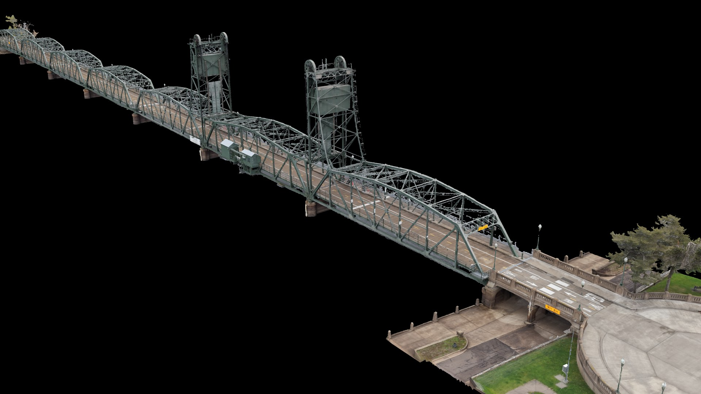

---

## The bridge

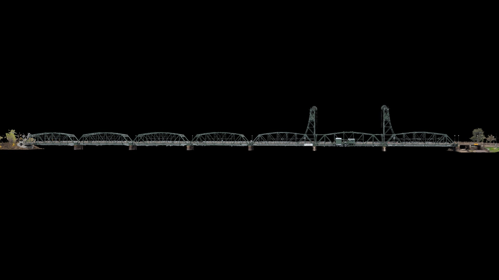

The Stillwater Lift Bridge opened in 1931, a vertical-lift bridge carrying the road across the
St. Croix River between Stillwater, Minnesota and Houlton, Wisconsin. It is 1,050 ft (320 m)
long: seven steel truss spans, including a 140 ft (43 m) lift span between two towers. It was
listed on the National Register of Historic Places in 1989.

It closed to cars on August 2, 2017, when the new St. Croix Crossing opened, and
reopened on June 1, 2020 for people on foot and on bikes, as part of a 4.7-mile loop trail
across both bridges. The lift span still rises for boats.
([Wikipedia](https://en.wikipedia.org/wiki/Stillwater_Bridge_(St._Croix_River)),
[MnDOT](https://content.govdelivery.com/accounts/MNDOT/bulletins/2969025))

I first scanned the bridge in 2020 with a Faro S150 laser scanner and never finished it. This
is the second attempt, with a drone. I waited for an overcast day, so there are no shadows
anywhere in the set.

## Solving it

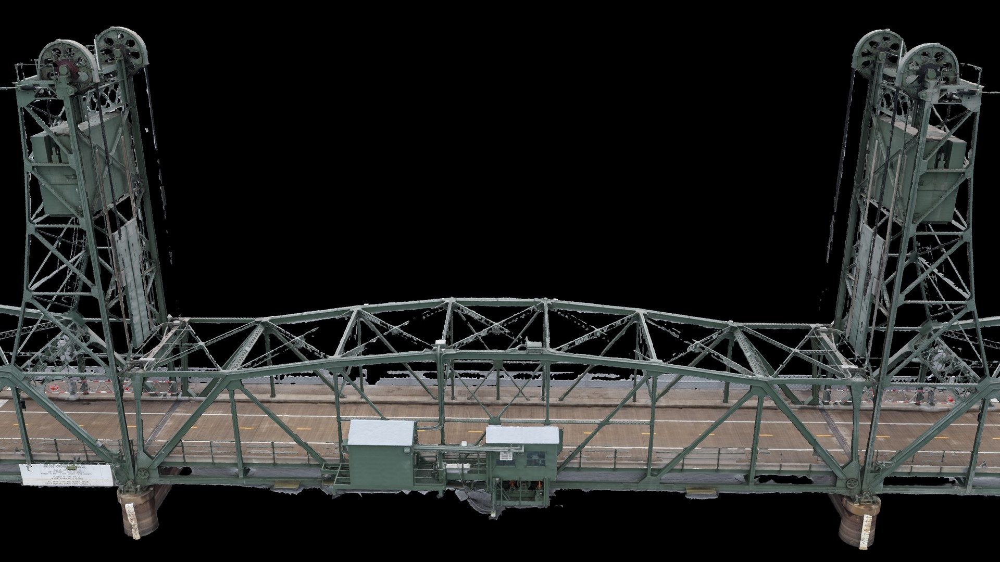

The spans repeat almost exactly, and a solver that matches photos on what they look like alone
can mistake one span for the next.

**[RealityScan](https://www.realityscan.com)** split the photos into 9 pieces. The largest held 2,047 of the 2,223. Inside it, a
run of 18 photos sat about 45 m from where they were taken, about one span off. The level side
passes were left out or stacked onto about two spans. Turning on GPS in RealityScan tilted the
model instead: the drone's recorded GPS altitude shifted by up to 11.6 m over the day.

**[OpenDroneMap](https://github.com/OpenDroneMap/ODM)** solved it with `--matcher-neighbors 30`: each photo is compared only with the
30 photos taken closest to it.
Photos a span apart are then rarely compared at all. Two more settings made the difference:

- **Height above takeoff instead of GPS altitude.** All the flights took off from the same
  height, so the drone's barometric height above takeoff is consistent across the day where its
  GPS altitude is not. [`odm/geo.txt`](odm/geo.txt) gives ODM each photo's GPS position with that
  height.
- **Full resolution** (`--feature-quality ultra`), 10,000 features per photo.

The result: **2,222 of 2,223 photos in one model**, every flight within 2–7 m of its GPS track
(median per flight), and the level side passes running the full length of the bridge, 0.5–1.3 %
from their GPS length. The one miss (`DJI_20261031122835_0682_D.JPG`) was placed 115 m from where
it was taken; it is left out of the poses and still ships as a photo.

The ODM cameras were then loaded into RealityScan with their positions locked, to build and
texture the mesh shown here. The published poses are ODM's positions and orientations exactly,
with the lens calibration RealityScan refined ([below](#camera-poses)).

## How it was flown

Every mission but the side passes was planned in [QGIS](https://github.com/qgis/QGIS) with
[FlyPath](https://github.com/dronnix-io/FlyPath); the six side passes were set up on site. A photo every 3 seconds throughout, five batteries, 10:42 to 13:55.

**The towers** — five stacked rings around each lift tower, flown as two missions per tower,
then two rings around both.

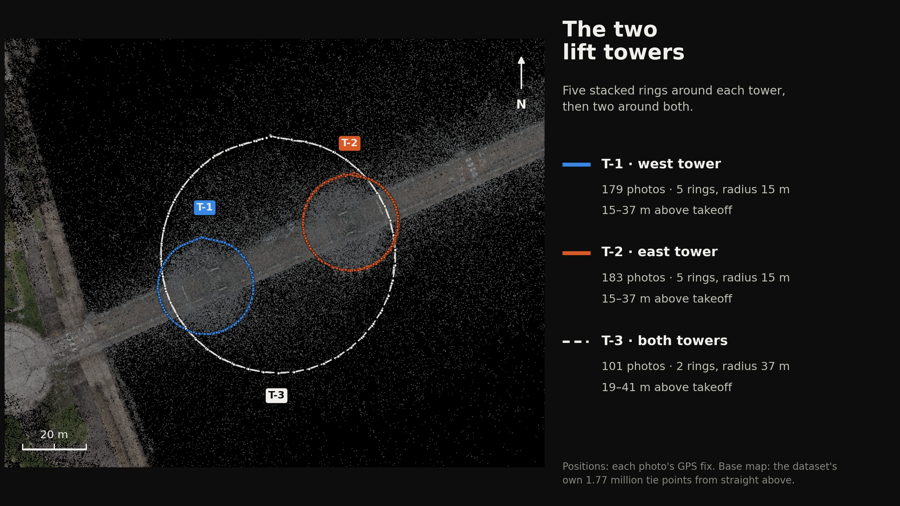

**The orbits** — 16 small rings down the length of the bridge, each overlapping the last by
half, then five large ones over the same length.

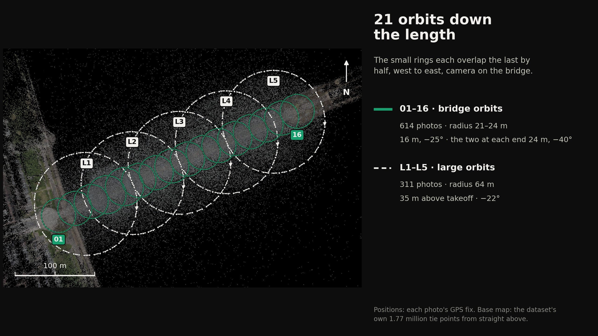

**The grids** — straight down at 40 m, three lines along the bridge, then back and forth across it.

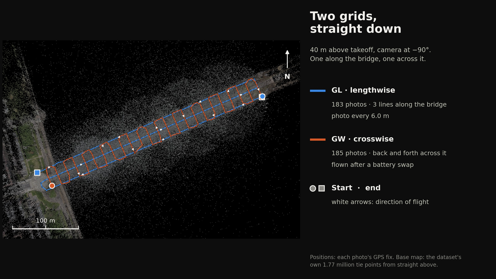

**The side passes** — along the north side, then the south: −45°, −22°, then level.

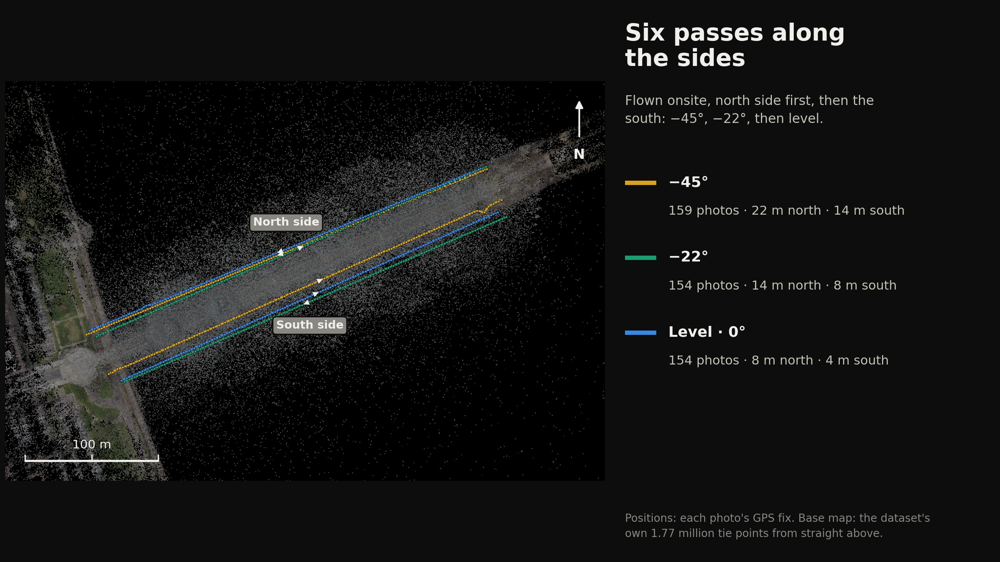

| missions | battery | type | time | photos | height above takeoff | camera |
|---|---|---|---|---|---|---|
| T-1 | 1 | west tower, 5 rings, radius 15 m | 10:42–10:52 | 179 | 15–37 m | −15° to −45° |
| T-2 | 1 | east tower, 5 rings, radius 15 m | 10:53–11:03 | 183 | 15–37 m | −15° to −45° (2 frames at 0°) |
| T-3 | 1 | both towers, 2 rings, radius 37 m | 11:04–11:09 | 101 | 19–41 m | −20° to −35° |
| 01–16 | 1–2 | bridge orbits, radius 21–24 m, west to east | 11:10–11:54 | 614 | 16 m; 01, 02, 15, 16 at 24 m | −25°; −40° at 24 m |
| L1–L5 | 3 | large orbits, radius 64 m | 12:15–12:34 | 311 | 35 m | −22° |
| GL | 3 | grid, 3 lines along the bridge | 12:35–12:45 | 183 | 40 m | −90° |
| GW | 4 | grid, back and forth across it | 12:48–12:59 | 185 | 40 m | −90° |
| N-45, N-22, N-0 | 4 | north side passes | 13:04–13:24 | 238 | 22, 14, 8 m | −44°, −22°, 0° |
| S-45, S-22, S-0 | 5 | south side passes | 13:30–13:55 | 229 | 14, 8, 4 m | −45°, −22°, 0° |

Each photo's mission, its name on the controller and its battery are in the `mission`,
`mission_code` and `battery` columns of
[`images.csv`](https://github.com/Matt1Up/stillwater-lift-bridge-photogrammetry-dataset/blob/main/manifest/bridge/images.csv),
with one row per mission in
[`missions.csv`](https://github.com/Matt1Up/stillwater-lift-bridge-photogrammetry-dataset/blob/main/manifest/bridge/missions.csv).
That makes it easy to train or solve on one part of the capture: only the towers, only the
grids, or one orbit at a time.

## Gallery

Renders of the textured model reconstructed from these photographs. The model itself is not
part of the dataset.

| | |
|---|---|
| 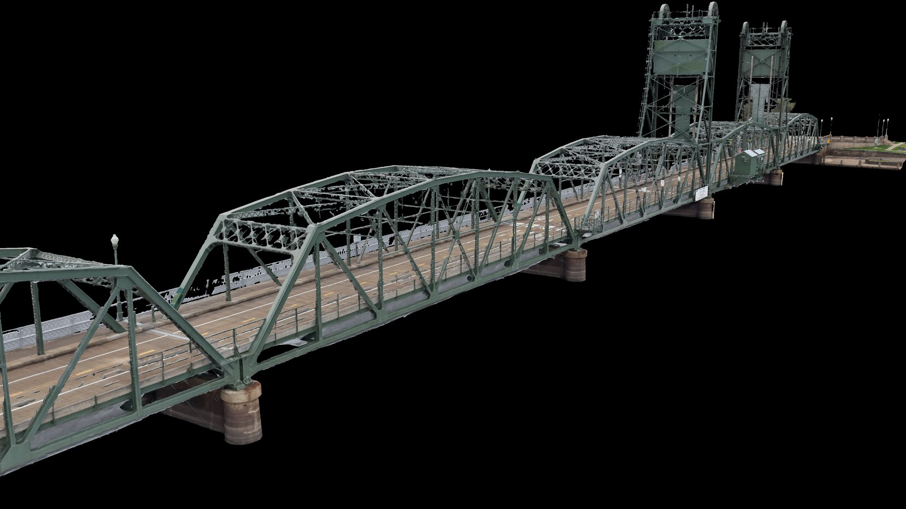 | 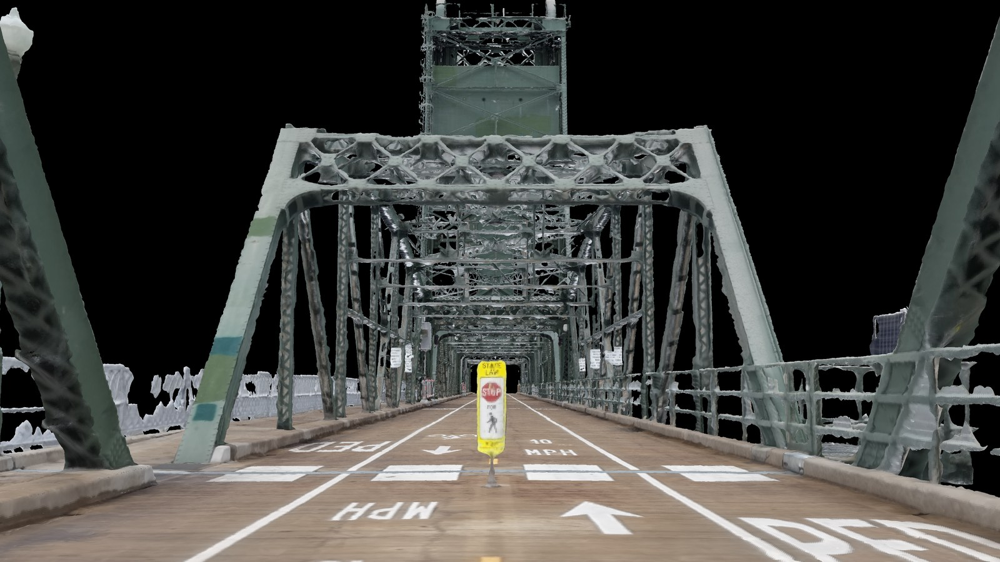 |
| 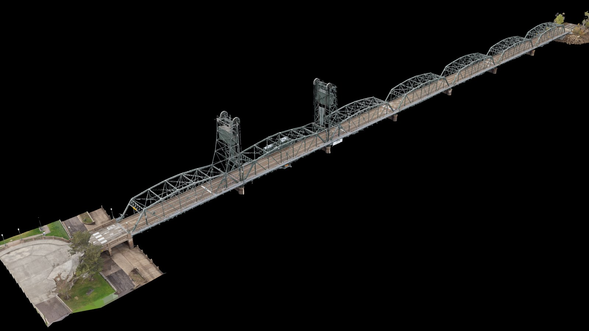 | 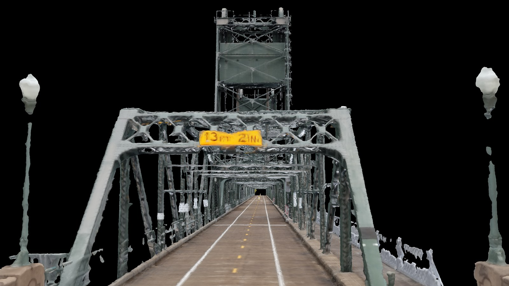 |
| 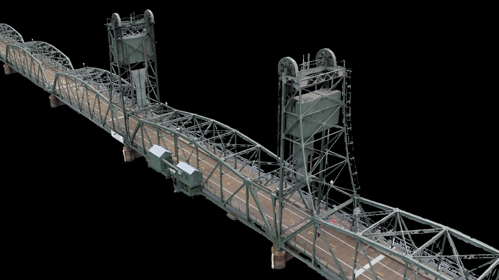 | 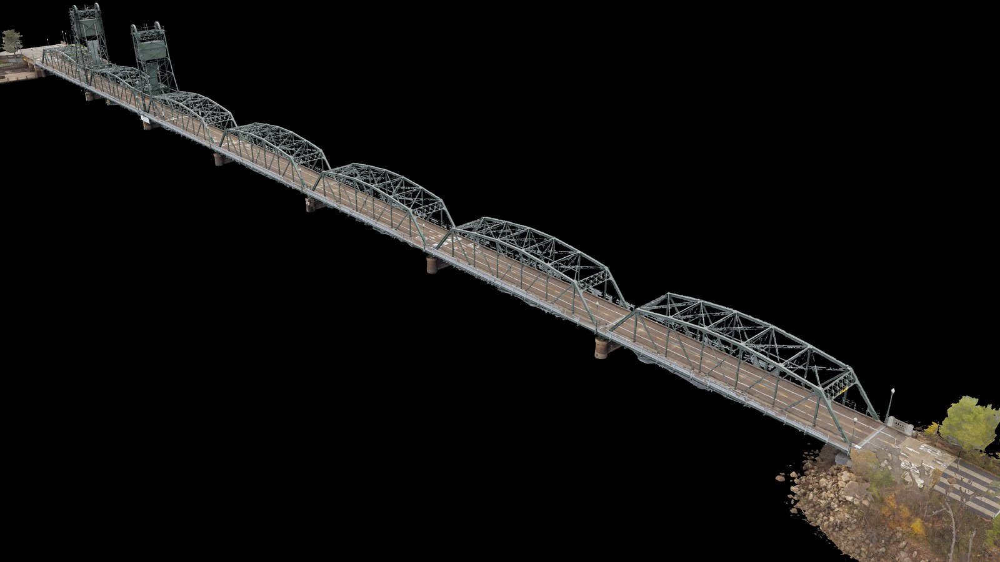 |
| 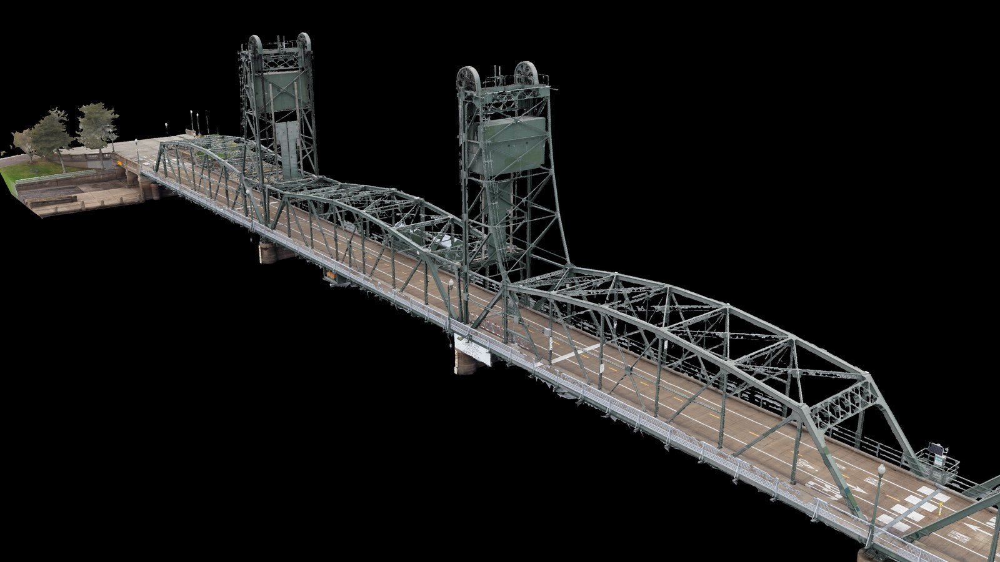 | 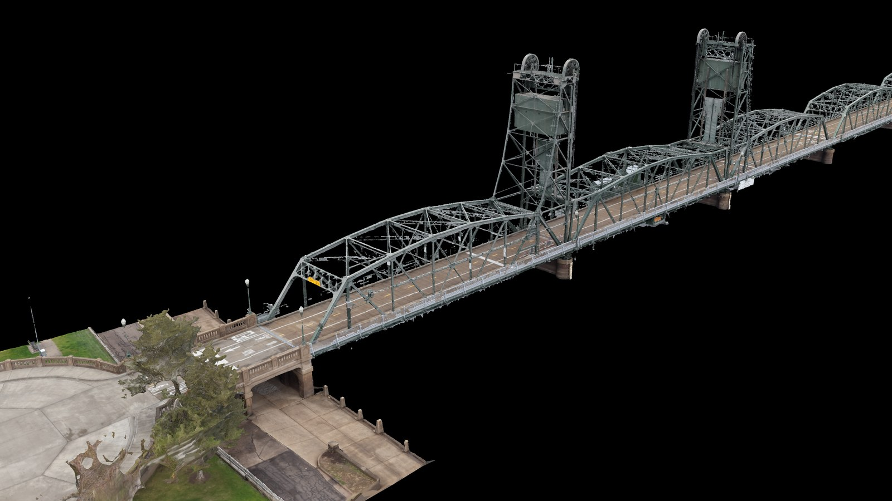 |
| 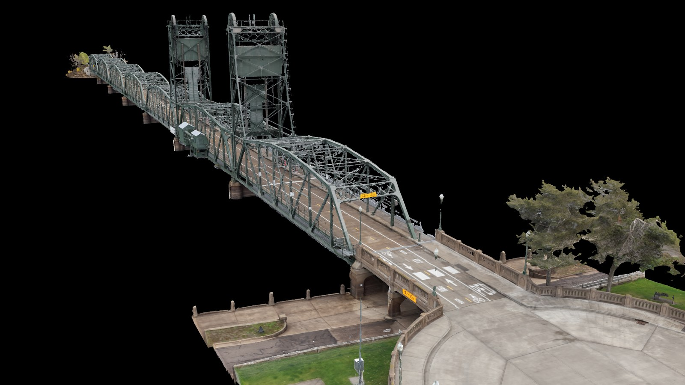 | |

## What's in it

| | |
|---|---|
| images | 2,223 |
| size | 20.06 GB |
| missions | 34 — 5 tower, 16 bridge orbits, 5 large orbits, 2 grids, 6 side passes |
| aligned | **2,222 / 2,223**, one OpenDroneMap model |
| camera poses | COLMAP and RealityScan XMP, for the original photos ([below](#camera-poses)) |
| tie points | 1,768,660 (RealityScan) · 1,045,349 (ODM) |
| ODM solve | command, GPS file, configuration and reconstruction ([below](#the-odm-solve)) |
| coordinate frame | meters, from GPS — no physical scale reference |

## Capture

| | |
|---|---|
| **Camera** | DJI FC9313, 8.7 mm, f/1.8 |
| **Resolution** | 4096 × 3072 — native sensor readout, not an interpolated mode |
| **Exposure** | manual, ISO 400, 1/1000 s to 1/2000 s |
| **White balance** | fixed, the same on every frame |
| **Geotagging** | GPS on every frame — 2,223 / 2,223 |
| **Filenames** | original as written by the aircraft |
| **Files** | 1,873 camera originals byte for byte; 350 with faces or plates blurred ([below](#blurred-faces-and-plates)) |
| **Flown** | Saturday, October 31, 2026, 10:42–13:55 local time, overcast, five batteries |
| **Height** | 4 m to 41 m above the takeoff point |
| **Gimbal** | −90° for the grids, −15° to −45° for the rings and orbits, down to level for the side passes |

Native resolution matters. These drones offer a higher-megapixel mode that interpolates from
the same sensor — it invents texture, and a photogrammetry solver treats invented texture as
real observations. Everything here is the native readout.

## Blurred faces and plates

People were on the bridge while it was flown. In **350 of the 2,223 images**, faces or license
plates are blurred, found with SAM 3 and blurred only where large enough to recognize (faces
30 px and up, plates 25–39 px). Nothing else in those images changed, and **the other 1,873 are
camera originals**, byte for byte. The camera solve used the unblurred originals.

The 350 keep their size, the camera's JPEG tables and all EXIF and DJI XMP; DJI's embedded preview
image was removed and the thumbnail remade, so neither shows a face. The list is in
[`manifest/bridge/blurred.txt`](https://github.com/Matt1Up/stillwater-lift-bridge-photogrammetry-dataset/blob/main/manifest/bridge/blurred.txt)
and the `edited` column of `images.csv`.

## Coordinate frame

Meters, x east, y north, z up, from origin 45.056708, −92.802381; z is height above takeoff plus
118.5 m, not an elevation. **There is no physical scale reference**: the frame comes from GPS, and
solved cameras sit 2.3 m (median) from their GPS positions. Fine for orientation and approximate
measures, not for survey work. Details in
[`poses/bridge/frame.txt`](https://github.com/Matt1Up/stillwater-lift-bridge-photogrammetry-dataset/blob/main/poses/bridge/frame.txt).

## Camera poses

ODM's cameras with RealityScan's refined lens, for **the original photos** as they are, no
undistortion needed: 2,222 poses, one shared `FULL_OPENCV` calibration (written once per image),
in the frame above.

| file | GitHub | Hugging Face | size |
|---|---|---|---|
| `cameras.txt`, `images.txt` | [`poses/bridge/colmap/`](https://github.com/Matt1Up/stillwater-lift-bridge-photogrammetry-dataset/tree/main/poses/bridge/colmap) | `bridge/poses/colmap/` | 0.6 MB |
| `points3D.txt`, 1,768,660 tie points | too big for GitHub | [`bridge/poses/colmap/points3D.txt`](https://huggingface.co/datasets/Matt1up/stillwater-lift-bridge-photogrammetry/resolve/main/bridge/poses/colmap/points3D.txt) | 0.09 GB |
| RealityScan XMP, one per photo | [`poses/bridge/xmp/`](https://github.com/Matt1Up/stillwater-lift-bridge-photogrammetry-dataset/tree/main/poses/bridge/xmp) | `bridge/poses/xmp/` | 3 MB |

Checksums are in
[`manifest/bridge/poses.sha256`](https://github.com/Matt1Up/stillwater-lift-bridge-photogrammetry-dataset/blob/main/manifest/bridge/poses.sha256).

## The ODM solve

Everything needed to run the solve again, or to use ODM's result directly:

| file | what it is |
|---|---|
| [`odm/command.txt`](odm/command.txt) | the exact ODM 3.6.2 command and options |
| [`odm/geo.txt`](odm/geo.txt) | each photo's GPS position, with height above takeoff + 118.5 m |
| [`odm/opensfm-config.yaml`](odm/opensfm-config.yaml) | the OpenSfM configuration ODM generated from those options |
| [`odm/camera_models.json`](odm/camera_models.json), [`odm/reference_lla.json`](odm/reference_lla.json) | the lens model and the frame's origin |
| [`odm/reconstruction-cameras.json`](odm/reconstruction-cameras.json) | ODM's solved cameras |
| `odm/reconstruction.json` (Hugging Face only, 0.35 GB) | the full reconstruction, with its 1,045,349 points |

ODM ran the camera solve only (`--end-with opensfm`): about 6 hours 20 minutes for features,
39,618 photo pairs matched, and the incremental solve.

## Gaussian splatting

The poses and tie points load straight into 3DGS and NeRF pipelines, no structure-from-motion
needed. Pinhole-only tools need undistorted copies first (COLMAP's `image_undistorter`).

## Download details

**→ [huggingface.co/datasets/Matt1up/stillwater-lift-bridge-photogrammetry](https://huggingface.co/datasets/Matt1up/stillwater-lift-bridge-photogrammetry)**

**Everything in one file** — the ZIP, 20.06 GB (20,060,468,980 bytes). Stored, not compressed:
the JPEGs inside are the published files, byte for byte, in one folder.

```bash
curl -LO https://huggingface.co/datasets/Matt1up/stillwater-lift-bridge-photogrammetry/resolve/main/zip/stillwater-lift-bridge-images.zip
sha256sum stillwater-lift-bridge-images.zip
# 9f3f692a70e9fb5e9f9a2cf25df04c01a98d40a7d593e13d1a29e8ca3560d689
unzip stillwater-lift-bridge-images.zip
```

If the download stops, `curl -C - -LO <same URL>` carries on from where it stopped.

**One file at a time, one command.** Run it again if it stops — finished files are skipped.

```bash
pip install -U huggingface_hub
hf download Matt1up/stillwater-lift-bridge-photogrammetry --repo-type dataset --local-dir ./bridge --include 'bridge/images/*'
```

Leave out `--include` to take everything: images, ZIP, poses and the ODM solve (40.58 GB — the
images twice).

**Or the helper scripts** from the [GitHub repo](https://github.com/Matt1Up/stillwater-lift-bridge-photogrammetry-dataset),
which wrap the same command and add `verify.sh` to check every file against the published
SHA-256 lists:

```bash
git clone https://github.com/Matt1Up/stillwater-lift-bridge-photogrammetry-dataset && cd stillwater-lift-bridge-photogrammetry-dataset

./scripts/download.sh --images   # 20.06 GB, file by file
./scripts/download.sh --zip      # 20.06 GB, one file
./scripts/download.sh --poses    # poses and tie points (0.10 GB)
./scripts/download.sh --odm      # the ODM solve (0.35 GB)
./scripts/verify.sh
```

More detail in **[docs/download.md](https://github.com/Matt1Up/stillwater-lift-bridge-photogrammetry-dataset/blob/main/docs/download.md)**.

## License

[](https://creativecommons.org/licenses/by/4.0/)

[Creative Commons Attribution 4.0](LICENSE). Commercial use and ML training are fine. Credit required.

```
Stillwater Lift Bridge | Stillwater, Minnesota, USA — Matthew Guertin, 2026. CC BY 4.0.
https://github.com/Matt1Up/stillwater-lift-bridge-photogrammetry-dataset
```

## Related

- **[Thirteen Mission Waypoint Drone Survey](https://github.com/Matt1Up/plymouth-mn-residential-survey-photogrammetry-dataset)** — a residential complex in Plymouth, Minnesota, flown as 13 waypoint missions.
- **[Abandoned Graffiti Mill](https://github.com/Matt1Up/abandoned-graffiti-mill-photogrammetry-dataset)** — the Früen Mill in Minneapolis, inside and out, metrically scaled.
- **[Drone building scans](https://github.com/Matt1Up/drone-building-scans-dataset)** — two commercial buildings, with poses.
- **[Tree photogrammetry dataset](https://github.com/Matt1Up/tree-photogrammetry-dataset)** — 812 images of one tree, with COLMAP poses.
- **[Chicago / Grant Park](https://github.com/Matt1Up/chicago-photogrammetry-dataset)** — 2,751 aerial images and 241 laser scan files over downtown Chicago.
- **[mattguertin.com](https://mattguertin.com)**
